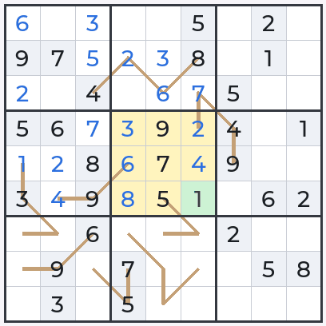

<!-- Written by tools/walkthrough.py nabner: edit the script, not this page. -->
# Nabner, step 18: the 1 in box 5

**Step 18 of 52** · [← Step 17](step-17.md) · [All steps](../nabner.md#the-whole-puzzle-step-by-step) · [Step 19 →](step-19.md)

Box 5 needs a 1, and r6c6 is its last empty cell: **r6c6 = 1**.

**Step 18 of 52** · [← Step 17](step-17.md) · [All steps](../nabner.md#the-whole-puzzle-step-by-step) · [Step 19 →](step-19.md)
