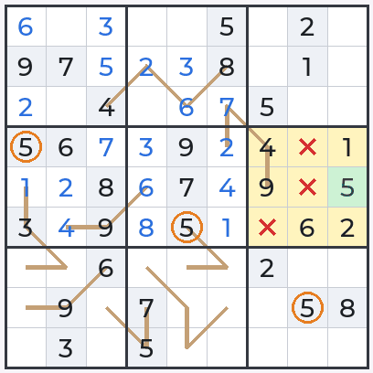

<!-- Written by tools/walkthrough.py nabner: edit the script, not this page. -->
# Nabner, step 19: the 5 in box 6

**Step 19 of 52** · [← Step 18](step-18.md) · [All steps](../nabner.md#the-whole-puzzle-step-by-step) · [Step 20 →](step-20.md)

Box 6 needs a 5. r4c8: row 4 has one (r4c1). r5c8: column 8 has one (r8c8). r6c7: row 6 has one (r6c5). Only **r5c9** is left: **r5c9 = 5**.

**Step 19 of 52** · [← Step 18](step-18.md) · [All steps](../nabner.md#the-whole-puzzle-step-by-step) · [Step 20 →](step-20.md)
