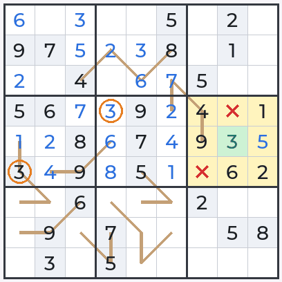

<!-- Written by tools/walkthrough.py nabner: edit the script, not this page. -->
# Nabner, step 20: the 3 in box 6

**Step 20 of 52** · [← Step 19](step-19.md) · [All steps](../nabner.md#the-whole-puzzle-step-by-step) · [Step 21 →](step-21.md)

Box 6 needs a 3. r4c8: row 4 has one (r4c4). r6c7: row 6 has one (r6c1). Only **r5c8** is left: **r5c8 = 3**.

**Step 20 of 52** · [← Step 19](step-19.md) · [All steps](../nabner.md#the-whole-puzzle-step-by-step) · [Step 21 →](step-21.md)
