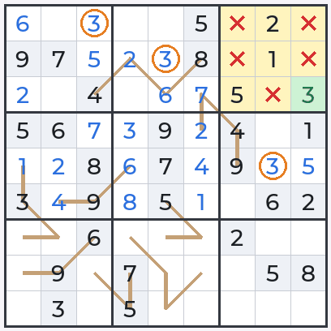

<!-- Written by tools/walkthrough.py nabner: edit the script, not this page. -->
# Nabner, step 21: the 3 in box 3

**Step 21 of 52** · [← Step 20](step-20.md) · [All steps](../nabner.md#the-whole-puzzle-step-by-step) · [Step 22 →](step-22.md)

Box 3 needs a 3. r1c7 and r1c9: row 1 has one (r1c3). r2c7 and r2c9: row 2 has one (r2c5). r3c8: column 8 has one (r5c8). Only **r3c9** is left: **r3c9 = 3**.

**Step 21 of 52** · [← Step 20](step-20.md) · [All steps](../nabner.md#the-whole-puzzle-step-by-step) · [Step 22 →](step-22.md)
