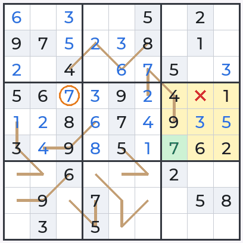

<!-- Written by tools/walkthrough.py nabner: edit the script, not this page. -->
# Nabner, step 22: the 7 in box 6

**Step 22 of 52** · [← Step 21](step-21.md) · [All steps](../nabner.md#the-whole-puzzle-step-by-step) · [Step 23 →](step-23.md)

Box 6 needs a 7. r4c8: row 4 has one (r4c3). Only **r6c7** is left: **r6c7 = 7**.

**Step 22 of 52** · [← Step 21](step-21.md) · [All steps](../nabner.md#the-whole-puzzle-step-by-step) · [Step 23 →](step-23.md)
