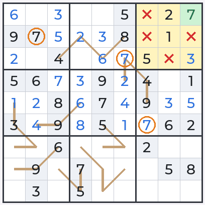

<!-- Written by tools/walkthrough.py nabner: edit the script, not this page. -->
# Nabner, step 23: the 7 in box 3

**Step 23 of 52** · [← Step 22](step-22.md) · [All steps](../nabner.md#the-whole-puzzle-step-by-step) · [Step 24 →](step-24.md)

Box 3 needs a 7. r1c7: column 7 has one (r6c7). r2c7 and r2c9: row 2 has one (r2c2). r3c8: row 3 has one (r3c6). Only **r1c9** is left: **r1c9 = 7**.

**Step 23 of 52** · [← Step 22](step-22.md) · [All steps](../nabner.md#the-whole-puzzle-step-by-step) · [Step 24 →](step-24.md)
