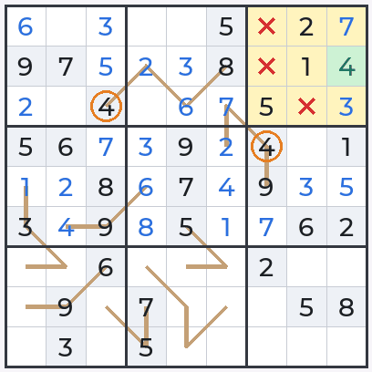

<!-- Written by tools/walkthrough.py nabner: edit the script, not this page. -->
# Nabner, step 24: the 4 in box 3

**Step 24 of 52** · [← Step 23](step-23.md) · [All steps](../nabner.md#the-whole-puzzle-step-by-step) · [Step 25 →](step-25.md)

Box 3 needs a 4. r1c7 and r2c7: column 7 has one (r4c7). r3c8: row 3 has one (r3c3). Only **r2c9** is left: **r2c9 = 4**.

**Step 24 of 52** · [← Step 23](step-23.md) · [All steps](../nabner.md#the-whole-puzzle-step-by-step) · [Step 25 →](step-25.md)
