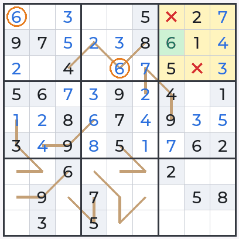

<!-- Written by tools/walkthrough.py nabner: edit the script, not this page. -->
# Nabner, step 25: the 6 in box 3

**Step 25 of 52** · [← Step 24](step-24.md) · [All steps](../nabner.md#the-whole-puzzle-step-by-step) · [Step 26 →](step-26.md)

Box 3 needs a 6. r1c7: row 1 has one (r1c1). r3c8: row 3 has one (r3c5). Only **r2c7** is left: **r2c7 = 6**.

**Step 25 of 52** · [← Step 24](step-24.md) · [All steps](../nabner.md#the-whole-puzzle-step-by-step) · [Step 26 →](step-26.md)
