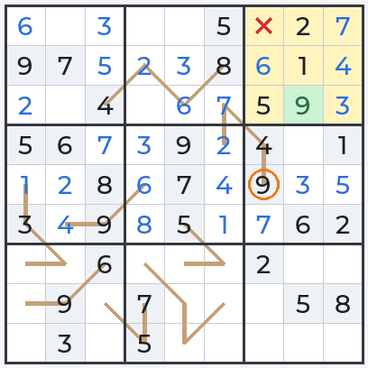

<!-- Written by tools/walkthrough.py nabner: edit the script, not this page. -->
# Nabner, step 26: the 9 in box 3

**Step 26 of 52** · [← Step 25](step-25.md) · [All steps](../nabner.md#the-whole-puzzle-step-by-step) · [Step 27 →](step-27.md)

Box 3 needs a 9. r1c7: column 7 has one (r5c7). Only **r3c8** is left: **r3c8 = 9**.

**Step 26 of 52** · [← Step 25](step-25.md) · [All steps](../nabner.md#the-whole-puzzle-step-by-step) · [Step 27 →](step-27.md)
