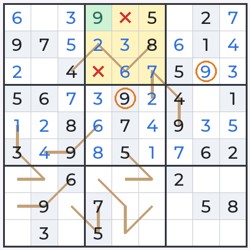

<!-- Written by tools/walkthrough.py nabner: edit the script, not this page. -->
# Nabner, step 27: the 9 in box 2

**Step 27 of 52** · [← Step 26](step-26.md) · [All steps](../nabner.md#the-whole-puzzle-step-by-step) · [Step 28 →](step-28.md)

Box 2 needs a 9. r1c5: column 5 has one (r4c5). r3c4: row 3 has one (r3c8). Only **r1c4** is left: **r1c4 = 9**.

**Step 27 of 52** · [← Step 26](step-26.md) · [All steps](../nabner.md#the-whole-puzzle-step-by-step) · [Step 28 →](step-28.md)
