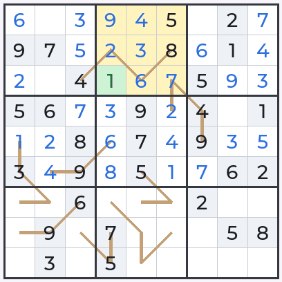

<!-- Written by tools/walkthrough.py nabner: edit the script, not this page. -->
# Nabner, step 29: the 1 in box 2

**Step 29 of 52** · [← Step 28](step-28.md) · [All steps](../nabner.md#the-whole-puzzle-step-by-step) · [Step 30 →](step-30.md)

Box 2 needs a 1, and r3c4 is its last empty cell: **r3c4 = 1**.

**Step 29 of 52** · [← Step 28](step-28.md) · [All steps](../nabner.md#the-whole-puzzle-step-by-step) · [Step 30 →](step-30.md)
