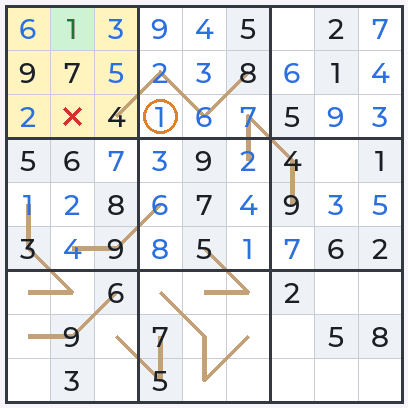

<!-- Written by tools/walkthrough.py nabner: edit the script, not this page. -->
# Nabner, step 30: the 1 in box 1

**Step 30 of 52** · [← Step 29](step-29.md) · [All steps](../nabner.md#the-whole-puzzle-step-by-step) · [Step 31 →](step-31.md)

Box 1 needs a 1. r3c2: row 3 has one (r3c4). Only **r1c2** is left: **r1c2 = 1**.

**Step 30 of 52** · [← Step 29](step-29.md) · [All steps](../nabner.md#the-whole-puzzle-step-by-step) · [Step 31 →](step-31.md)
