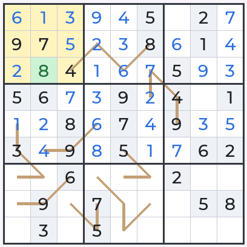

<!-- Written by tools/walkthrough.py nabner: edit the script, not this page. -->
# Nabner, step 31: the 8 in box 1

**Step 31 of 52** · [← Step 30](step-30.md) · [All steps](../nabner.md#the-whole-puzzle-step-by-step) · [Step 32 →](step-32.md)

Box 1 needs an 8, and r3c2 is its last empty cell: **r3c2 = 8**.

**Step 31 of 52** · [← Step 30](step-30.md) · [All steps](../nabner.md#the-whole-puzzle-step-by-step) · [Step 32 →](step-32.md)
