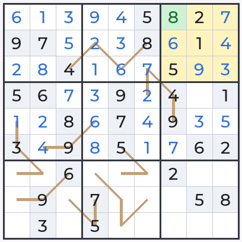

<!-- Written by tools/walkthrough.py nabner: edit the script, not this page. -->
# Nabner, step 32: the 8 in box 3

**Step 32 of 52** · [← Step 31](step-31.md) · [All steps](../nabner.md#the-whole-puzzle-step-by-step) · [Step 33 →](step-33.md)

Box 3 needs an 8, and r1c7 is its last empty cell: **r1c7 = 8**.

**Step 32 of 52** · [← Step 31](step-31.md) · [All steps](../nabner.md#the-whole-puzzle-step-by-step) · [Step 33 →](step-33.md)
