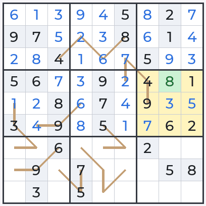

<!-- Written by tools/walkthrough.py nabner: edit the script, not this page. -->
# Nabner, step 33: the 8 in box 6

**Step 33 of 52** · [← Step 32](step-32.md) · [All steps](../nabner.md#the-whole-puzzle-step-by-step) · [Step 34 →](step-34.md)

Box 6 needs an 8, and r4c8 is its last empty cell: **r4c8 = 8**.

**Step 33 of 52** · [← Step 32](step-32.md) · [All steps](../nabner.md#the-whole-puzzle-step-by-step) · [Step 34 →](step-34.md)
