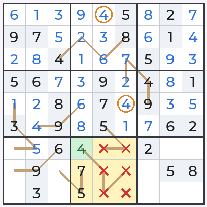

<!-- Written by tools/walkthrough.py nabner: edit the script, not this page. -->
# Nabner, step 35: the 4 in box 8

**Step 35 of 52** · [← Step 34](step-34.md) · [All steps](../nabner.md#the-whole-puzzle-step-by-step) · [Step 36 →](step-36.md)

Box 8 needs a 4. r7c5, r8c5 and r9c5: column 5 has one (r1c5). r7c6, r8c6 and r9c6: column 6 has one (r5c6). Only **r7c4** is left: **r7c4 = 4**.

**Step 35 of 52** · [← Step 34](step-34.md) · [All steps](../nabner.md#the-whole-puzzle-step-by-step) · [Step 36 →](step-36.md)
