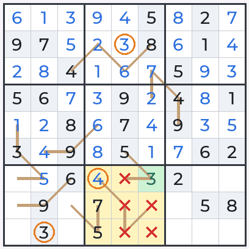

<!-- Written by tools/walkthrough.py nabner: edit the script, not this page. -->
# Nabner, step 36: the 3 in box 8

**Step 36 of 52** · [← Step 35](step-35.md) · [All steps](../nabner.md#the-whole-puzzle-step-by-step) · [Step 37 →](step-37.md)

Box 8 needs a 3. r7c5 and r8c5: column 5 has one (r2c5). r9c5 and r9c6: row 9 has one (r9c2). r8c6: the 4 in r7c4 is on its brown line too, and 3 is 1 away from it. Only **r7c6** is left: **r7c6 = 3**.

**Step 36 of 52** · [← Step 35](step-35.md) · [All steps](../nabner.md#the-whole-puzzle-step-by-step) · [Step 37 →](step-37.md)
