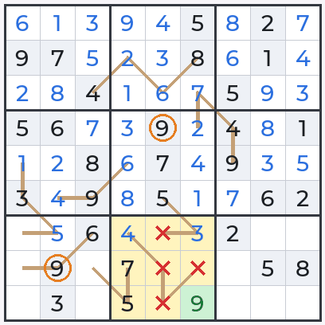

<!-- Written by tools/walkthrough.py nabner: edit the script, not this page. -->
# Nabner, step 37: the 9 in box 8

**Step 37 of 52** · [← Step 36](step-36.md) · [All steps](../nabner.md#the-whole-puzzle-step-by-step) · [Step 38 →](step-38.md)

Box 8 needs a 9. r7c5 and r9c5: column 5 has one (r4c5). r8c5 and r8c6: row 8 has one (r8c2). Only **r9c6** is left: **r9c6 = 9**.

**Step 37 of 52** · [← Step 36](step-36.md) · [All steps](../nabner.md#the-whole-puzzle-step-by-step) · [Step 38 →](step-38.md)
