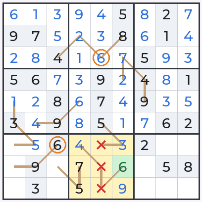

<!-- Written by tools/walkthrough.py nabner: edit the script, not this page. -->
# Nabner, step 38: the 6 in box 8

**Step 38 of 52** · [← Step 37](step-37.md) · [All steps](../nabner.md#the-whole-puzzle-step-by-step) · [Step 39 →](step-39.md)

Box 8 needs a 6. r7c5: row 7 has one (r7c3). r8c5 and r9c5: column 5 has one (r3c5). Only **r8c6** is left: **r8c6 = 6**.

**Step 38 of 52** · [← Step 37](step-37.md) · [All steps](../nabner.md#the-whole-puzzle-step-by-step) · [Step 39 →](step-39.md)
