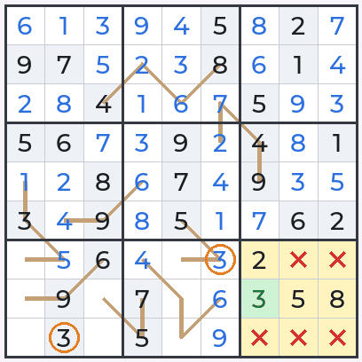

<!-- Written by tools/walkthrough.py nabner: edit the script, not this page. -->
# Nabner, step 39: the 3 in box 9

**Step 39 of 52** · [← Step 38](step-38.md) · [All steps](../nabner.md#the-whole-puzzle-step-by-step) · [Step 40 →](step-40.md)

Box 9 needs a 3. r7c8 and r7c9: row 7 has one (r7c6). r9c7, r9c8 and r9c9: row 9 has one (r9c2). Only **r8c7** is left: **r8c7 = 3**.

**Step 39 of 52** · [← Step 38](step-38.md) · [All steps](../nabner.md#the-whole-puzzle-step-by-step) · [Step 40 →](step-40.md)
