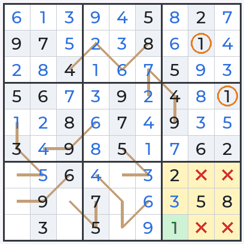

<!-- Written by tools/walkthrough.py nabner: edit the script, not this page. -->
# Nabner, step 40: the 1 in box 9

**Step 40 of 52** · [← Step 39](step-39.md) · [All steps](../nabner.md#the-whole-puzzle-step-by-step) · [Step 41 →](step-41.md)

Box 9 needs a 1. r7c8 and r9c8: column 8 has one (r2c8). r7c9 and r9c9: column 9 has one (r4c9). Only **r9c7** is left: **r9c7 = 1**.

**Step 40 of 52** · [← Step 39](step-39.md) · [All steps](../nabner.md#the-whole-puzzle-step-by-step) · [Step 41 →](step-41.md)
