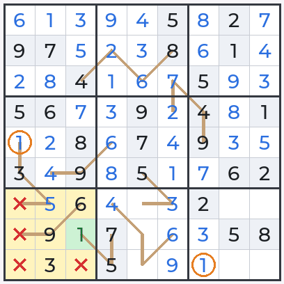

<!-- Written by tools/walkthrough.py nabner: edit the script, not this page. -->
# Nabner, step 41: the 1 in box 7

**Step 41 of 52** · [← Step 40](step-40.md) · [All steps](../nabner.md#the-whole-puzzle-step-by-step) · [Step 42 →](step-42.md)

Box 7 needs a 1. r7c1 and r8c1: column 1 has one (r5c1). r9c1 and r9c3: row 9 has one (r9c7). Only **r8c3** is left: **r8c3 = 1**.

**Step 41 of 52** · [← Step 40](step-40.md) · [All steps](../nabner.md#the-whole-puzzle-step-by-step) · [Step 42 →](step-42.md)
