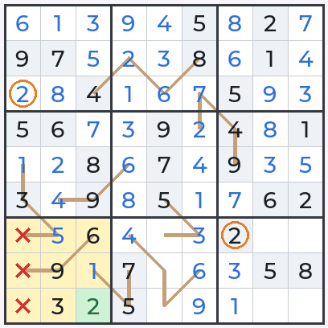

<!-- Written by tools/walkthrough.py nabner: edit the script, not this page. -->
# Nabner, step 42: the 2 in box 7

**Step 42 of 52** · [← Step 41](step-41.md) · [All steps](../nabner.md#the-whole-puzzle-step-by-step) · [Step 43 →](step-43.md)

Box 7 needs a 2. r7c1: row 7 has one (r7c7). r8c1 and r9c1: column 1 has one (r3c1). Only **r9c3** is left: **r9c3 = 2**.

**Step 42 of 52** · [← Step 41](step-41.md) · [All steps](../nabner.md#the-whole-puzzle-step-by-step) · [Step 43 →](step-43.md)
