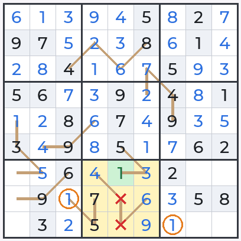

<!-- Written by tools/walkthrough.py nabner: edit the script, not this page. -->
# Nabner, step 43: the 1 in box 8

**Step 43 of 52** · [← Step 42](step-42.md) · [All steps](../nabner.md#the-whole-puzzle-step-by-step) · [Step 44 →](step-44.md)

Box 8 needs a 1. r8c5: row 8 has one (r8c3). r9c5: row 9 has one (r9c7). Only **r7c5** is left: **r7c5 = 1**.

**Step 43 of 52** · [← Step 42](step-42.md) · [All steps](../nabner.md#the-whole-puzzle-step-by-step) · [Step 44 →](step-44.md)
