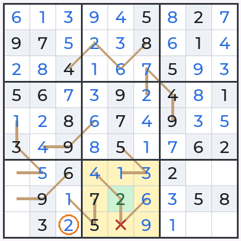

<!-- Written by tools/walkthrough.py nabner: edit the script, not this page. -->
# Nabner, step 44: the 2 in box 8

**Step 44 of 52** · [← Step 43](step-43.md) · [All steps](../nabner.md#the-whole-puzzle-step-by-step) · [Step 45 →](step-45.md)

Box 8 needs a 2. r9c5: row 9 has one (r9c3). Only **r8c5** is left: **r8c5 = 2**.

**Step 44 of 52** · [← Step 43](step-43.md) · [All steps](../nabner.md#the-whole-puzzle-step-by-step) · [Step 45 →](step-45.md)
