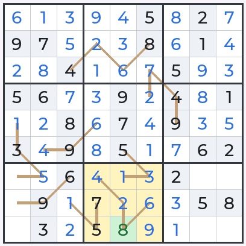

<!-- Written by tools/walkthrough.py nabner: edit the script, not this page. -->
# Nabner, step 45: the 8 in box 8

**Step 45 of 52** · [← Step 44](step-44.md) · [All steps](../nabner.md#the-whole-puzzle-step-by-step) · [Step 46 →](step-46.md)

Box 8 needs an 8, and r9c5 is its last empty cell: **r9c5 = 8**.

**Step 45 of 52** · [← Step 44](step-44.md) · [All steps](../nabner.md#the-whole-puzzle-step-by-step) · [Step 46 →](step-46.md)
