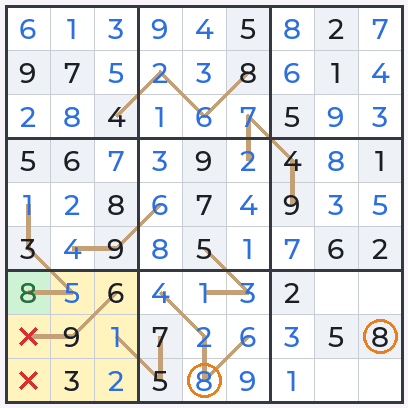

<!-- Written by tools/walkthrough.py nabner: edit the script, not this page. -->
# Nabner, step 46: the 8 in box 7

**Step 46 of 52** · [← Step 45](step-45.md) · [All steps](../nabner.md#the-whole-puzzle-step-by-step) · [Step 47 →](step-47.md)

Box 7 needs an 8. r8c1: row 8 has one (r8c9). r9c1: row 9 has one (r9c5). Only **r7c1** is left: **r7c1 = 8**.

**Step 46 of 52** · [← Step 45](step-45.md) · [All steps](../nabner.md#the-whole-puzzle-step-by-step) · [Step 47 →](step-47.md)
