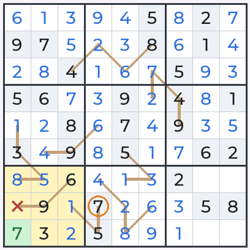

<!-- Written by tools/walkthrough.py nabner: edit the script, not this page. -->
# Nabner, step 47: the 7 in box 7

**Step 47 of 52** · [← Step 46](step-46.md) · [All steps](../nabner.md#the-whole-puzzle-step-by-step) · [Step 48 →](step-48.md)

Box 7 needs a 7. r8c1: row 8 has one (r8c4). Only **r9c1** is left: **r9c1 = 7**.

**Step 47 of 52** · [← Step 46](step-46.md) · [All steps](../nabner.md#the-whole-puzzle-step-by-step) · [Step 48 →](step-48.md)
