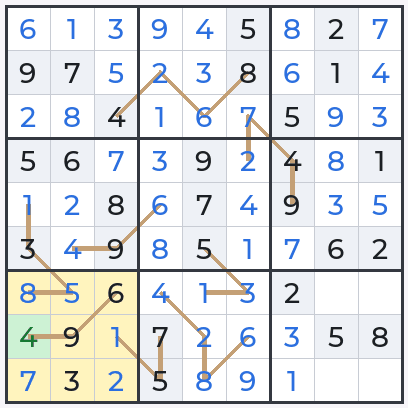

<!-- Written by tools/walkthrough.py nabner: edit the script, not this page. -->
# Nabner, step 48: the 4 in box 7

**Step 48 of 52** · [← Step 47](step-47.md) · [All steps](../nabner.md#the-whole-puzzle-step-by-step) · [Step 49 →](step-49.md)

Box 7 needs a 4, and r8c1 is its last empty cell: **r8c1 = 4**.

**Step 48 of 52** · [← Step 47](step-47.md) · [All steps](../nabner.md#the-whole-puzzle-step-by-step) · [Step 49 →](step-49.md)
