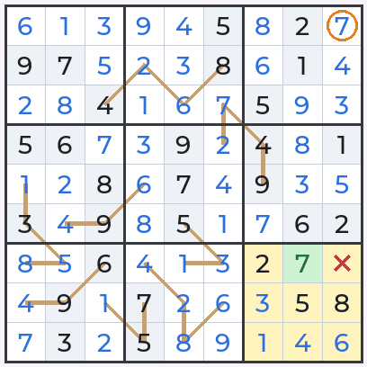

<!-- Written by tools/walkthrough.py nabner: edit the script, not this page. -->
# Nabner, step 51: the 7 in box 9

**Step 51 of 52** · [← Step 50](step-50.md) · [All steps](../nabner.md#the-whole-puzzle-step-by-step) · [Step 52 →](step-52.md)

Box 9 needs a 7. r7c9: column 9 has one (r1c9). Only **r7c8** is left: **r7c8 = 7**.

**Step 51 of 52** · [← Step 50](step-50.md) · [All steps](../nabner.md#the-whole-puzzle-step-by-step) · [Step 52 →](step-52.md)
