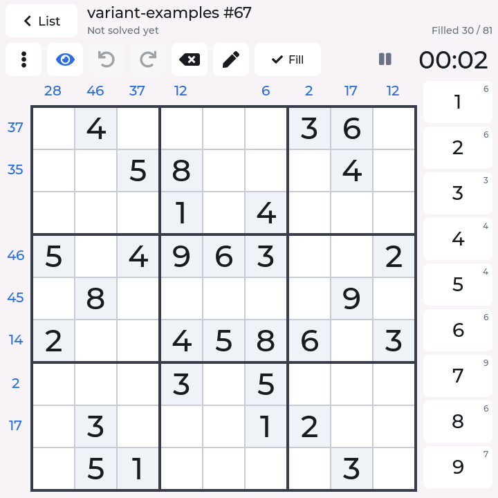
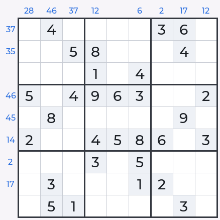

# Next to Nine

[← All variants](README.md) · [Puzzles](../features-puzzles.md) · [How to play](../how-to-play.md)

## The rules

[Classic](classic.md) rules, and **clues outside the grid**: a clue left of a row or above a column lists **the digits right beside that row's or column's 9**, in any order. Two digits for a 9 with a cell on each side; one digit for a 9 at an end of its row or column. A line without a clue says nothing.

## On the board

- The clues sit left of the rows and above the columns, their digits side by side (as Outside Sudoku's).
- A digit beside a 9 that its clue doesn't list turns red, with the 9; so does a 9 at an end when the clue has two digits, or one in the middle when it has one.
- The grader and hints know one step: once a line with a clue has 4 empty cells or fewer, every order of its missing digits is tried against the clue, and the hint names the clue's digits and what the ways left allow in the cell.
- **Puzzles → ⋮ → New puzzle → Clues → Next to Nine**: three quarters of the lines have a clue (Hard and Expert: three fifths).

## How to solve it

- **One digit: the 9 is at an end.** It's first or last in its row or column, with that digit beside it; the seven cells between are never 9.
- **Where can the 9 go?** It needs the clue's digits beside it: a 9 next to a digit the clue doesn't list can't be there, and neither can one whose neighbours are taken by other digits.
- **The clue's digits stay close:** once the 9 is placed, the clue's digits are the two cells beside it, so they're nowhere else in that line.

## Worked example

**variant-examples #67**, Next to Nine Easy (see [Classic](classic.md#worked-example-the-whole-puzzle) for how to import the examples; cells are written r*row*c*column*).

**Step 1: r5c4.** Row 5 has 8 and 9; column 4 has 8, 1, 9, 4 and 3; box 5 has 9, 6, 3, 4, 5 and 8. By the Classic rules r5c4 could be 2 or 7. Column 4's 9 is r4c4, with the 1 in r3c4 above it, and column 4's clue is **12**: the cell below the 9 is 2. **r5c4 = 2**.

**Step 2: r6c3.** Row 6's clue is **14**: the 9 has a 1 and a 4 beside it. Row 6 reads 2, ., ., 4, 5, 8, 6, ., 3: the 4 is r6c4 and the cell after it is 5, so the 9 is before the 4. By the Classic rules r6c3 could be 7 or 9. **r6c3 = 9**.

**Step 3: r6c2.** The other cell beside row 6's 9 takes the clue's other digit; by the Classic rules it could be 1 or 7. **r6c2 = 1**.

## The whole puzzle, step by step

<!-- walkthrough -->
<!-- Written by tools/walkthrough.py next-to-nine: edit the script, not this part. -->

The whole puzzle, from the start to the last cell: 51 steps, each one a single (one place left for a digit, or one digit left for a cell), taken in the order a box's single comes first, so not quite the order of the worked example above. Each step has a page of its own, with **Previous** and **Next**: pick its number below. In each picture, the unit the step looks at is tinted yellow (for a cell with one digit left: its row, column and box), the new digit is on green, the digits that rule cells out have an **orange ring**, and the empty cells they rule out a **red cross**. Givens are on grey, digits from earlier steps in blue.

| [1](next-to-nine/step-01.md) | [2](next-to-nine/step-02.md) | [3](next-to-nine/step-03.md) | [4](next-to-nine/step-04.md) | [5](next-to-nine/step-05.md) | [6](next-to-nine/step-06.md) | [7](next-to-nine/step-07.md) | [8](next-to-nine/step-08.md) | [9](next-to-nine/step-09.md) | [10](next-to-nine/step-10.md) |
|:-:|:-:|:-:|:-:|:-:|:-:|:-:|:-:|:-:|:-:|
| [11](next-to-nine/step-11.md) | [12](next-to-nine/step-12.md) | [13](next-to-nine/step-13.md) | [14](next-to-nine/step-14.md) | [15](next-to-nine/step-15.md) | [16](next-to-nine/step-16.md) | [17](next-to-nine/step-17.md) | [18](next-to-nine/step-18.md) | [19](next-to-nine/step-19.md) | [20](next-to-nine/step-20.md) |
| [21](next-to-nine/step-21.md) | [22](next-to-nine/step-22.md) | [23](next-to-nine/step-23.md) | [24](next-to-nine/step-24.md) | [25](next-to-nine/step-25.md) | [26](next-to-nine/step-26.md) | [27](next-to-nine/step-27.md) | [28](next-to-nine/step-28.md) | [29](next-to-nine/step-29.md) | [30](next-to-nine/step-30.md) |
| [31](next-to-nine/step-31.md) | [32](next-to-nine/step-32.md) | [33](next-to-nine/step-33.md) | [34](next-to-nine/step-34.md) | [35](next-to-nine/step-35.md) | [36](next-to-nine/step-36.md) | [37](next-to-nine/step-37.md) | [38](next-to-nine/step-38.md) | [39](next-to-nine/step-39.md) | [40](next-to-nine/step-40.md) |
| [41](next-to-nine/step-41.md) | [42](next-to-nine/step-42.md) | [43](next-to-nine/step-43.md) | [44](next-to-nine/step-44.md) | [45](next-to-nine/step-45.md) | [46](next-to-nine/step-46.md) | [47](next-to-nine/step-47.md) | [48](next-to-nine/step-48.md) | [49](next-to-nine/step-49.md) | [50](next-to-nine/step-50.md) |
| [51](next-to-nine/step-51.md) |  |  |  |  |  |  |  |  |  |

Solved.

<!-- /walkthrough -->
