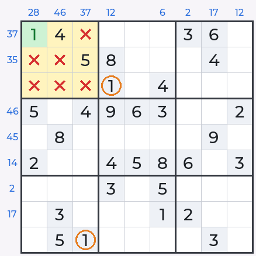

<!-- Written by tools/walkthrough.py next-to-nine: edit the script, not this page. -->
# Next to Nine, step 1: the 1 in box 1

**Step 1 of 51** · [← The start](../next-to-nine.md#the-whole-puzzle-step-by-step) · [All steps](../next-to-nine.md#the-whole-puzzle-step-by-step) · [Step 2 →](step-02.md)

Box 1 needs a 1. r1c3: column 3 has one (r9c3). r3c1, r3c2 and r3c3: row 3 has one (r3c4). r2c1 and r2c2: with a 1 there, row 2 couldn't have 3 and 5 beside its 9. Only **r1c1** is left: **r1c1 = 1**.

**Step 1 of 51** · [← The start](../next-to-nine.md#the-whole-puzzle-step-by-step) · [All steps](../next-to-nine.md#the-whole-puzzle-step-by-step) · [Step 2 →](step-02.md)
