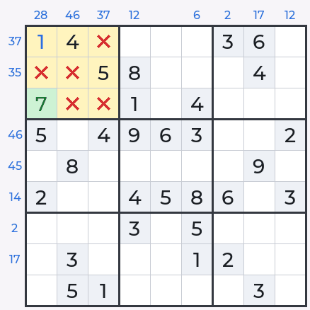

<!-- Written by tools/walkthrough.py next-to-nine: edit the script, not this page. -->
# Next to Nine, step 2: the 7 in box 1

**Step 2 of 51** · [← Step 1](step-01.md) · [All steps](../next-to-nine.md#the-whole-puzzle-step-by-step) · [Step 3 →](step-03.md)

Box 1 needs a 7. r1c3: with a 7 there, row 1 couldn't have 3 and 7 beside its 9. r2c1 and r2c2: with a 7 there, row 2 couldn't have 3 and 5 beside its 9. r3c2: with a 7 there, column 2 couldn't have 4 and 6 beside its 9. r3c3: with a 7 there, column 3 couldn't have 3 and 7 beside its 9. Only **r3c1** is left: **r3c1 = 7**.

**Step 2 of 51** · [← Step 1](step-01.md) · [All steps](../next-to-nine.md#the-whole-puzzle-step-by-step) · [Step 3 →](step-03.md)
