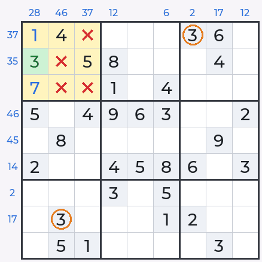

<!-- Written by tools/walkthrough.py next-to-nine: edit the script, not this page. -->
# Next to Nine, step 3: the 3 in box 1

**Step 3 of 51** · [← Step 2](step-02.md) · [All steps](../next-to-nine.md#the-whole-puzzle-step-by-step) · [Step 4 →](step-04.md)

Box 1 needs a 3. r1c3: row 1 has one (r1c7). r2c2 and r3c2: column 2 has one (r8c2). r3c3: with a 3 there, column 3 couldn't have 3 and 7 beside its 9. Only **r2c1** is left: **r2c1 = 3**.

**Step 3 of 51** · [← Step 2](step-02.md) · [All steps](../next-to-nine.md#the-whole-puzzle-step-by-step) · [Step 4 →](step-04.md)
