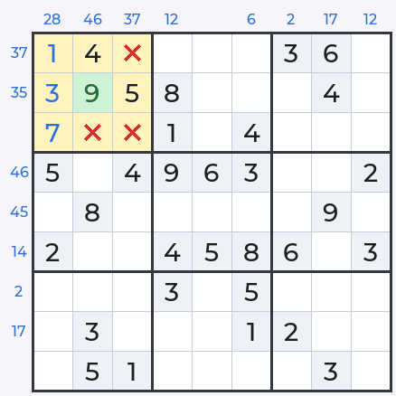

<!-- Written by tools/walkthrough.py next-to-nine: edit the script, not this page. -->
# Next to Nine, step 4: the 9 in box 1

**Step 4 of 51** · [← Step 3](step-03.md) · [All steps](../next-to-nine.md#the-whole-puzzle-step-by-step) · [Step 5 →](step-05.md)

Box 1 needs a 9. r1c3: a 9 there would have 4 and an empty cell beside it in row 1, not its clue's 3 and 7. r3c2: a 9 there would have an empty cell and an empty cell beside it in column 2, not its clue's 4 and 6. r3c3: a 9 there would have 5 and 4 beside it in column 3, not its clue's 3 and 7. Only **r2c2** is left: **r2c2 = 9**.

**Step 4 of 51** · [← Step 3](step-03.md) · [All steps](../next-to-nine.md#the-whole-puzzle-step-by-step) · [Step 5 →](step-05.md)
