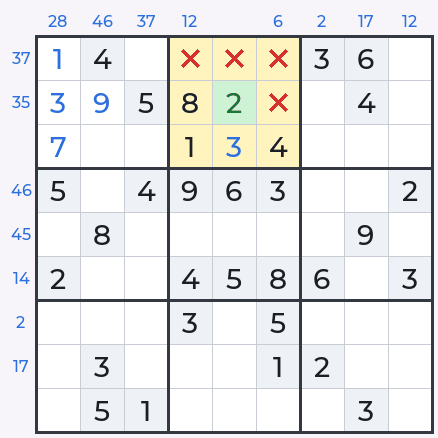

<!-- Written by tools/walkthrough.py next-to-nine: edit the script, not this page. -->
# Next to Nine, step 6: the 2 in box 2

**Step 6 of 51** · [← Step 5](step-05.md) · [All steps](../next-to-nine.md#the-whole-puzzle-step-by-step) · [Step 7 →](step-07.md)

Box 2 needs a 2. r1c4: with a 2 there, column 4 couldn't have 1 and 2 beside its 9. r1c5 and r1c6: with a 2 there, row 1 couldn't have 3 and 7 beside its 9. r2c6: with a 2 there, column 6 couldn't have 6 beside its 9. Only **r2c5** is left: **r2c5 = 2**.

**Step 6 of 51** · [← Step 5](step-05.md) · [All steps](../next-to-nine.md#the-whole-puzzle-step-by-step) · [Step 7 →](step-07.md)
