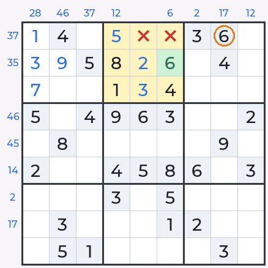

<!-- Written by tools/walkthrough.py next-to-nine: edit the script, not this page. -->
# Next to Nine, step 8: the 6 in box 2

**Step 8 of 51** · [← Step 7](step-07.md) · [All steps](../next-to-nine.md#the-whole-puzzle-step-by-step) · [Step 9 →](step-09.md)

Box 2 needs a 6. r1c5 and r1c6: row 1 has one (r1c8). Only **r2c6** is left: **r2c6 = 6**.

**Step 8 of 51** · [← Step 7](step-07.md) · [All steps](../next-to-nine.md#the-whole-puzzle-step-by-step) · [Step 9 →](step-09.md)
