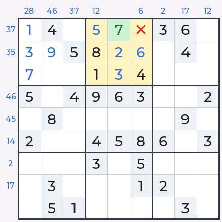

<!-- Written by tools/walkthrough.py next-to-nine: edit the script, not this page. -->
# Next to Nine, step 9: the 7 in box 2

**Step 9 of 51** · [← Step 8](step-08.md) · [All steps](../next-to-nine.md#the-whole-puzzle-step-by-step) · [Step 10 →](step-10.md)

Box 2 needs a 7. r1c6: with a 7 there, row 1 couldn't have 3 and 7 beside its 9. Only **r1c5** is left: **r1c5 = 7**.

**Step 9 of 51** · [← Step 8](step-08.md) · [All steps](../next-to-nine.md#the-whole-puzzle-step-by-step) · [Step 10 →](step-10.md)
