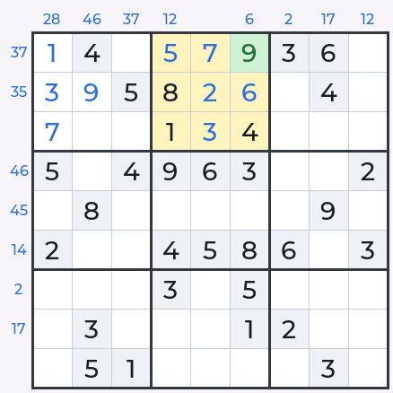

<!-- Written by tools/walkthrough.py next-to-nine: edit the script, not this page. -->
# Next to Nine, step 10: the 9 in box 2

**Step 10 of 51** · [← Step 9](step-09.md) · [All steps](../next-to-nine.md#the-whole-puzzle-step-by-step) · [Step 11 →](step-11.md)

Box 2 needs a 9, and r1c6 is its last empty cell: **r1c6 = 9**.

**Step 10 of 51** · [← Step 9](step-09.md) · [All steps](../next-to-nine.md#the-whole-puzzle-step-by-step) · [Step 11 →](step-11.md)
