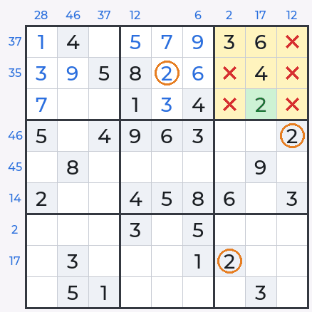

<!-- Written by tools/walkthrough.py next-to-nine: edit the script, not this page. -->
# Next to Nine, step 11: the 2 in box 3

**Step 11 of 51** · [← Step 10](step-10.md) · [All steps](../next-to-nine.md#the-whole-puzzle-step-by-step) · [Step 12 →](step-12.md)

Box 3 needs a 2. r1c9 and r3c9: column 9 has one (r4c9). r2c7 and r2c9: row 2 has one (r2c5). r3c7: column 7 has one (r8c7). Only **r3c8** is left: **r3c8 = 2**.

**Step 11 of 51** · [← Step 10](step-10.md) · [All steps](../next-to-nine.md#the-whole-puzzle-step-by-step) · [Step 12 →](step-12.md)
