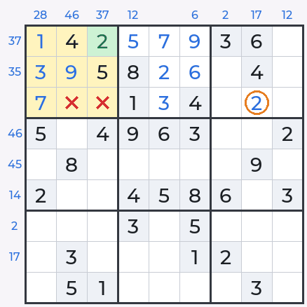

<!-- Written by tools/walkthrough.py next-to-nine: edit the script, not this page. -->
# Next to Nine, step 12: the 2 in box 1

**Step 12 of 51** · [← Step 11](step-11.md) · [All steps](../next-to-nine.md#the-whole-puzzle-step-by-step) · [Step 13 →](step-13.md)

Box 1 needs a 2. r3c2 and r3c3: row 3 has one (r3c8). Only **r1c3** is left: **r1c3 = 2**.

**Step 12 of 51** · [← Step 11](step-11.md) · [All steps](../next-to-nine.md#the-whole-puzzle-step-by-step) · [Step 13 →](step-13.md)
