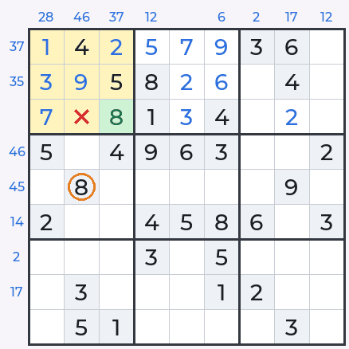

<!-- Written by tools/walkthrough.py next-to-nine: edit the script, not this page. -->
# Next to Nine, step 13: the 8 in box 1

**Step 13 of 51** · [← Step 12](step-12.md) · [All steps](../next-to-nine.md#the-whole-puzzle-step-by-step) · [Step 14 →](step-14.md)

Box 1 needs an 8. r3c2: column 2 has one (r5c2). Only **r3c3** is left: **r3c3 = 8**.

**Step 13 of 51** · [← Step 12](step-12.md) · [All steps](../next-to-nine.md#the-whole-puzzle-step-by-step) · [Step 14 →](step-14.md)
