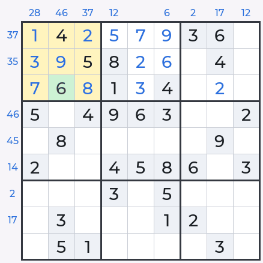

<!-- Written by tools/walkthrough.py next-to-nine: edit the script, not this page. -->
# Next to Nine, step 14: the 6 in box 1

**Step 14 of 51** · [← Step 13](step-13.md) · [All steps](../next-to-nine.md#the-whole-puzzle-step-by-step) · [Step 15 →](step-15.md)

Box 1 needs a 6, and r3c2 is its last empty cell: **r3c2 = 6**.

**Step 14 of 51** · [← Step 13](step-13.md) · [All steps](../next-to-nine.md#the-whole-puzzle-step-by-step) · [Step 15 →](step-15.md)
