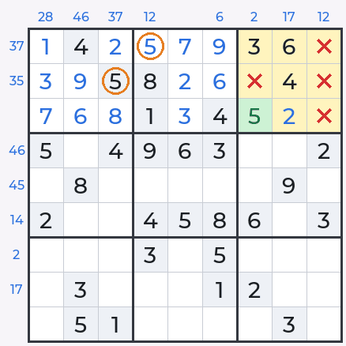

<!-- Written by tools/walkthrough.py next-to-nine: edit the script, not this page. -->
# Next to Nine, step 15: the 5 in box 3

**Step 15 of 51** · [← Step 14](step-14.md) · [All steps](../next-to-nine.md#the-whole-puzzle-step-by-step) · [Step 16 →](step-16.md)

Box 3 needs a 5. r1c9: row 1 has one (r1c4). r2c7 and r2c9: row 2 has one (r2c3). r3c9: with a 5 there, column 9 couldn't have 1 and 2 beside its 9. Only **r3c7** is left: **r3c7 = 5**.

**Step 15 of 51** · [← Step 14](step-14.md) · [All steps](../next-to-nine.md#the-whole-puzzle-step-by-step) · [Step 16 →](step-16.md)
