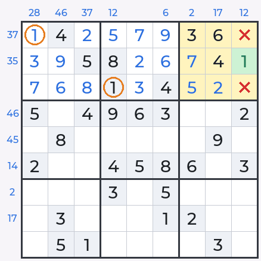

<!-- Written by tools/walkthrough.py next-to-nine: edit the script, not this page. -->
# Next to Nine, step 17: the 1 in box 3

**Step 17 of 51** · [← Step 16](step-16.md) · [All steps](../next-to-nine.md#the-whole-puzzle-step-by-step) · [Step 18 →](step-18.md)

Box 3 needs a 1. r1c9: row 1 has one (r1c1). r3c9: row 3 has one (r3c4). Only **r2c9** is left: **r2c9 = 1**.

**Step 17 of 51** · [← Step 16](step-16.md) · [All steps](../next-to-nine.md#the-whole-puzzle-step-by-step) · [Step 18 →](step-18.md)
