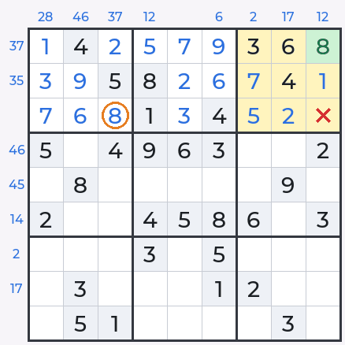

<!-- Written by tools/walkthrough.py next-to-nine: edit the script, not this page. -->
# Next to Nine, step 18: the 8 in box 3

**Step 18 of 51** · [← Step 17](step-17.md) · [All steps](../next-to-nine.md#the-whole-puzzle-step-by-step) · [Step 19 →](step-19.md)

Box 3 needs an 8. r3c9: row 3 has one (r3c3). Only **r1c9** is left: **r1c9 = 8**.

**Step 18 of 51** · [← Step 17](step-17.md) · [All steps](../next-to-nine.md#the-whole-puzzle-step-by-step) · [Step 19 →](step-19.md)
