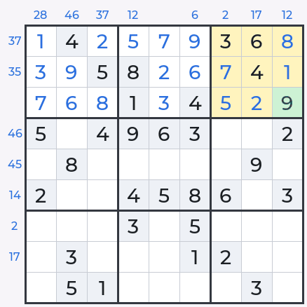

<!-- Written by tools/walkthrough.py next-to-nine: edit the script, not this page. -->
# Next to Nine, step 19: the 9 in box 3

**Step 19 of 51** · [← Step 18](step-18.md) · [All steps](../next-to-nine.md#the-whole-puzzle-step-by-step) · [Step 20 →](step-20.md)

Box 3 needs a 9, and r3c9 is its last empty cell: **r3c9 = 9**.

**Step 19 of 51** · [← Step 18](step-18.md) · [All steps](../next-to-nine.md#the-whole-puzzle-step-by-step) · [Step 20 →](step-20.md)
