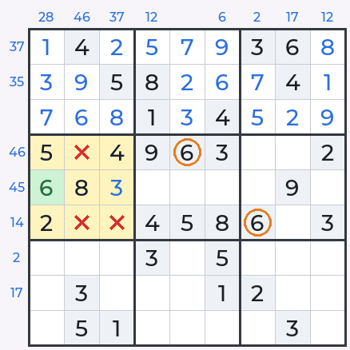

<!-- Written by tools/walkthrough.py next-to-nine: edit the script, not this page. -->
# Next to Nine, step 21: the 6 in box 4

**Step 21 of 51** · [← Step 20](step-20.md) · [All steps](../next-to-nine.md#the-whole-puzzle-step-by-step) · [Step 22 →](step-22.md)

Box 4 needs a 6. r4c2: row 4 has one (r4c5). r6c2 and r6c3: row 6 has one (r6c7). Only **r5c1** is left: **r5c1 = 6**.

**Step 21 of 51** · [← Step 20](step-20.md) · [All steps](../next-to-nine.md#the-whole-puzzle-step-by-step) · [Step 22 →](step-22.md)
