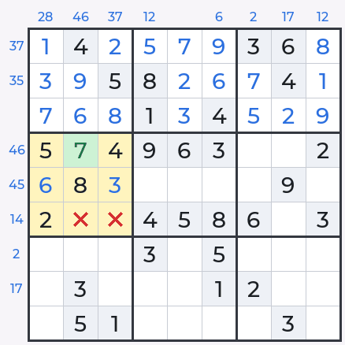

<!-- Written by tools/walkthrough.py next-to-nine: edit the script, not this page. -->
# Next to Nine, step 22: the 7 in box 4

**Step 22 of 51** · [← Step 21](step-21.md) · [All steps](../next-to-nine.md#the-whole-puzzle-step-by-step) · [Step 23 →](step-23.md)

Box 4 needs a 7. r6c2 and r6c3: with a 7 there, row 6 couldn't have 1 and 4 beside its 9. Only **r4c2** is left: **r4c2 = 7**.

**Step 22 of 51** · [← Step 21](step-21.md) · [All steps](../next-to-nine.md#the-whole-puzzle-step-by-step) · [Step 23 →](step-23.md)
