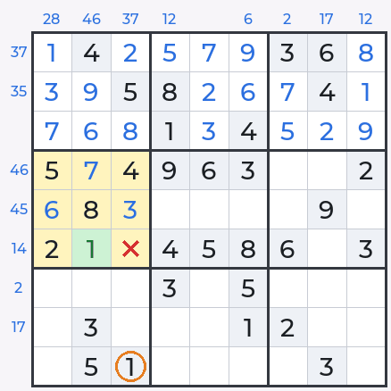

<!-- Written by tools/walkthrough.py next-to-nine: edit the script, not this page. -->
# Next to Nine, step 23: the 1 in box 4

**Step 23 of 51** · [← Step 22](step-22.md) · [All steps](../next-to-nine.md#the-whole-puzzle-step-by-step) · [Step 24 →](step-24.md)

Box 4 needs a 1. r6c3: column 3 has one (r9c3). Only **r6c2** is left: **r6c2 = 1**.

**Step 23 of 51** · [← Step 22](step-22.md) · [All steps](../next-to-nine.md#the-whole-puzzle-step-by-step) · [Step 24 →](step-24.md)
